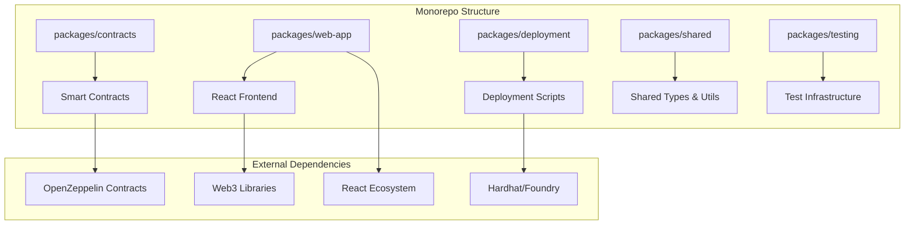
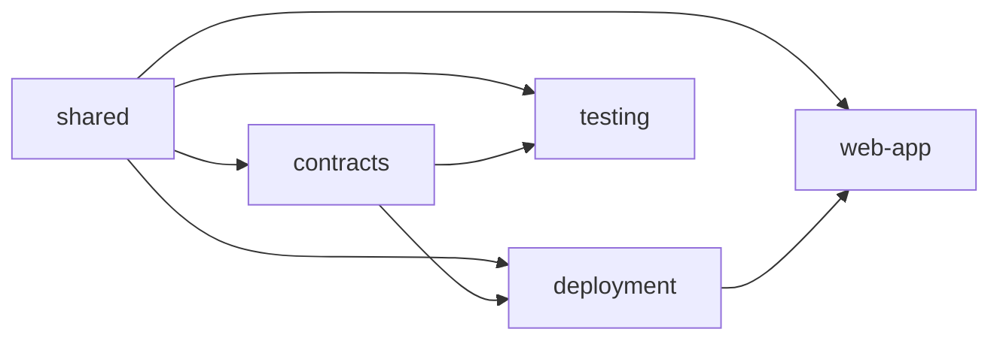

# Design Document

## Overview

The Nomad Coin monorepo will be structured as a modern TypeScript-based workspace using npm workspaces or Yarn workspaces. The architecture follows a modular approach with clear separation of concerns between smart contracts, deployment infrastructure, frontend applications, and shared utilities.

The current project has a basic ERC-20 token implementation that will be enhanced and integrated into a comprehensive ecosystem supporting multiple deployment targets, a user-friendly frontend, and robust testing infrastructure.

## Architecture

### High-Level Architecture



### Package Dependencies



## Components and Interfaces

### 1. Smart Contracts Package (`packages/contracts`)

**Core Components:**
- `NomadCoin.sol` - Enhanced ERC-20 implementation
- `NomadCoinProxy.sol` - Upgradeable proxy contract
- `NomadCoinGovernance.sol` - Governance mechanisms
- `interfaces/` - Contract interfaces and types

**Key Features:**
- Extends current MyToken with minting capabilities
- Implements OpenZeppelin's AccessControl for role management
- Supports EIP-2612 permits (already implemented via ERC20Permit)
- Upgradeable via proxy pattern
- Gas-optimized operations

**Interface Design:**
```solidity
interface INomadCoin {
    function mint(address to, uint256 amount) external;
    function burn(uint256 amount) external;
    function pause() external;
    function unpause() external;
    function grantMinterRole(address account) external;
    function revokeMinterRole(address account) external;
}
```

### 2. Web Application Package (`packages/web-app`)

**Architecture:** React + TypeScript + Vite
**State Management:** Zustand or Redux Toolkit
**Web3 Integration:** wagmi + viem
**UI Framework:** Tailwind CSS + shadcn/ui

**Core Components:**
- `WalletConnection` - Web3 wallet integration
- `TokenBalance` - Display user's Nomad Coin balance
- `TransferForm` - Send tokens interface
- `TransactionHistory` - View past transactions
- `NetworkSwitcher` - Handle multiple networks

**State Structure:**
```typescript
interface AppState {
  wallet: {
    address: string | null;
    isConnected: boolean;
    chainId: number;
  };
  token: {
    balance: bigint;
    allowances: Record<string, bigint>;
  };
  transactions: Transaction[];
}
```

### 3. Deployment Package (`packages/deployment`)

**Framework:** Hardhat with custom deployment scripts
**Network Support:** Local, Goerli, Sepolia, Mainnet
**Verification:** Automatic contract verification on Etherscan

**Core Scripts:**
- `deploy-token.ts` - Deploy Nomad Coin contracts
- `upgrade-token.ts` - Handle contract upgrades
- `verify-contracts.ts` - Verify on block explorers
- `setup-roles.ts` - Configure access control roles

**Configuration Management:**
```typescript
interface DeploymentConfig {
  networks: Record<string, NetworkConfig>;
  contracts: {
    nomadCoin: {
      name: string;
      symbol: string;
      initialSupply: bigint;
      minters: string[];
    };
  };
}
```

### 4. Shared Package (`packages/shared`)

**Purpose:** Common types, utilities, and constants
**Contents:**
- Contract ABIs and type definitions
- Network configurations
- Utility functions for address validation, formatting
- Constants for contract addresses per network

**Key Exports:**
```typescript
export interface ContractAddresses {
  nomadCoin: string;
  nomadCoinProxy: string;
}

export const NETWORK_CONFIGS: Record<number, NetworkConfig>;
export const CONTRACT_ADDRESSES: Record<number, ContractAddresses>;
```

### 5. Testing Package (`packages/testing`)

**Framework:** Hardhat + Chai for contracts, Vitest for TypeScript
**Coverage:** Unit tests, integration tests, gas optimization tests
**Mocking:** Mock contracts for frontend testing

**Test Categories:**
- Contract unit tests (Solidity)
- Deployment script tests (TypeScript)
- Frontend component tests (React Testing Library)
- End-to-end integration tests

## Data Models

### Smart Contract Data Models

```solidity
// Enhanced from current MyToken implementation
contract NomadCoin is ERC20, ERC20Permit, AccessControl, Pausable {
    bytes32 public constant MINTER_ROLE = keccak256("MINTER_ROLE");
    bytes32 public constant PAUSER_ROLE = keccak256("PAUSER_ROLE");
    
    uint256 public constant MAX_SUPPLY = 1_000_000_000 * 10**18; // 1B tokens
    
    mapping(address => bool) public blacklisted;
    
    event TokensMinted(address indexed to, uint256 amount);
    event TokensBurned(address indexed from, uint256 amount);
    event AddressBlacklisted(address indexed account);
}
```

### Frontend Data Models

```typescript
interface Transaction {
  hash: string;
  from: string;
  to: string;
  value: bigint;
  timestamp: number;
  status: 'pending' | 'confirmed' | 'failed';
  gasUsed?: bigint;
}

interface TokenInfo {
  name: string;
  symbol: string;
  decimals: number;
  totalSupply: bigint;
  userBalance: bigint;
}

interface NetworkInfo {
  chainId: number;
  name: string;
  rpcUrl: string;
  blockExplorer: string;
  contractAddresses: ContractAddresses;
}
```

## Error Handling

### Smart Contract Error Handling

```solidity
error InsufficientBalance(uint256 requested, uint256 available);
error ExceedsMaxSupply(uint256 requested, uint256 maxSupply);
error AddressBlacklisted(address account);
error UnauthorizedMinter(address account);
```

### Frontend Error Handling

**Error Categories:**
- Network errors (wrong chain, RPC failures)
- Transaction errors (insufficient gas, reverted transactions)
- User input errors (invalid addresses, amounts)
- Wallet connection errors

**Error Handling Strategy:**
- Global error boundary for React components
- Toast notifications for user-facing errors
- Retry mechanisms for network requests
- Graceful degradation when Web3 is unavailable

### Deployment Error Handling

**Strategies:**
- Pre-deployment validation checks
- Rollback mechanisms for failed deployments
- Comprehensive logging and monitoring
- Network-specific error handling

## Testing Strategy

### Smart Contract Testing

**Unit Tests:**
- Test all ERC-20 functions with edge cases
- Access control and role management tests
- Upgrade mechanism tests
- Gas optimization tests

**Integration Tests:**
- Multi-contract interaction tests
- Proxy upgrade scenarios
- Cross-network deployment validation

**Security Tests:**
- Reentrancy attack prevention
- Integer overflow/underflow protection
- Access control bypass attempts
- Front-running protection

### Frontend Testing

**Component Tests:**
- Individual component functionality
- User interaction flows
- Error state handling
- Responsive design validation

**Integration Tests:**
- Web3 wallet integration
- Contract interaction flows
- Network switching scenarios
- Transaction lifecycle testing

**E2E Tests:**
- Complete user journeys
- Multi-browser compatibility
- Performance testing
- Accessibility compliance

### Deployment Testing

**Pre-deployment:**
- Contract compilation verification
- Gas estimation accuracy
- Network configuration validation
- Access control setup verification

**Post-deployment:**
- Contract verification on explorers
- Function call testing
- Event emission verification
- Upgrade mechanism validation

## Development Workflow

### Monorepo Management

**Package Manager:** npm workspaces
**Build System:** Turborepo for efficient builds
**Version Management:** Changesets for coordinated releases

**Scripts:**
```json
{
  "scripts": {
    "build": "turbo run build",
    "test": "turbo run test",
    "lint": "turbo run lint",
    "deploy:local": "turbo run deploy --filter=deployment",
    "dev": "turbo run dev --parallel"
  }
}
```

### CI/CD Pipeline

**Stages:**
1. Code quality checks (lint, format, type-check)
2. Unit and integration tests
3. Security scans (Slither for contracts)
4. Build verification
5. Deployment to staging
6. E2E tests on staging
7. Production deployment (manual approval)

### Security Considerations

**Smart Contract Security:**
- Use OpenZeppelin audited contracts
- Implement proper access controls
- Add pause mechanisms for emergencies
- Regular security audits
- Bug bounty program

**Frontend Security:**
- Input validation and sanitization
- Secure storage of sensitive data
- Protection against XSS and CSRF
- Secure communication with contracts
- Regular dependency updates

**Infrastructure Security:**
- Secure key management
- Network isolation
- Monitoring and alerting
- Incident response procedures